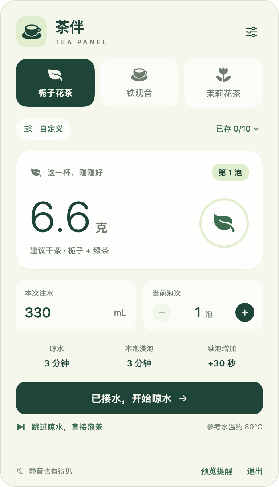
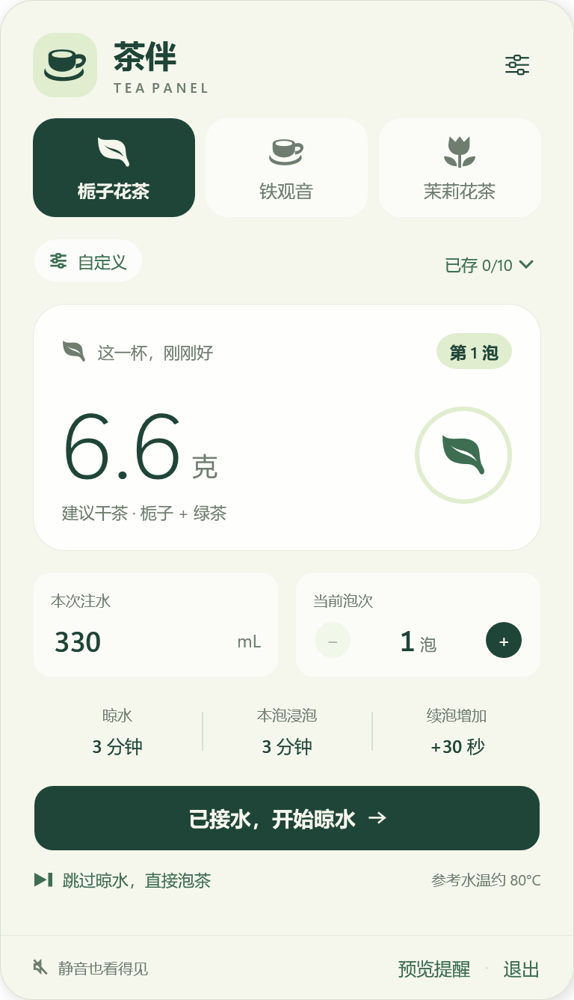

<p align="center">
  
</p>

<h1 align="center">Tea Panel</h1>

<p align="center">A quiet native tea brewing companion for the Mac menu bar and Windows system tray.</p>

<p align="center">
  <a href="README.md">简体中文</a> · <strong>English (US)</strong>
</p>

<p align="center">macOS 13+ / Apple Silicon · Windows 11 / x64 · MIT</p>

Tea Panel helps you brew a cup of tea while you work. Set your water volume, check the suggested amount of dry tea, and follow the cooling and steeping timers. When it's time to add leaves or remove your infuser, a silent floating card stays visible until you respond.

On macOS, the app is named **茶伴** on Simplified Chinese systems and **Tea Panel** in English. The Windows window is named **茶伴 · Tea Panel**, and its executable is `TeaPanel.exe`. Both interfaces and the default README use **Simplified Chinese**. This README uses American English; both versions describe the same behavior.

<p align="center">
  
  
</p>

## Features

- **Three built-in presets:** gardenia green tea, Tieguanyin oolong, and jasmine green tea.
- **Tea amounts that match your cup:** calculate dry tea from your water volume and preferred ratio.
- **Cooling and steeping stages:** confirm when you add the leaves, or skip cooling when you're ready to brew.
- **Refill support:** reuse the same leaves, add time with each infusion, and start at any infusion from 1 to 99.
- **Persistent, silent reminders:** see the countdown in the Mac menu bar, or the Windows panel and tray tooltip. A floating reminder stays until you respond.
- **Your own recipes:** save up to 10 configurations with custom names, icons, ratios, temperatures, and timing.
- **Local preferences:** cup settings, saved recipes, and the latest draft stay on your computer. The app makes no network requests.
- **Native interfaces:** SwiftUI/AppKit on macOS and C#/WPF/.NET 10 on Windows, with system animation preferences and no third-party application dependencies.

## Quick start

### Install on macOS

Download `Tea-Panel-<version>-Apple-Silicon.dmg` from [GitHub Releases](https://github.com/Pommissarzhu/Tea-Panel/releases). Open the disk image, drag **Tea Panel.app** into **Applications**, and launch it from there. The installer does not require Xcode or Command Line Tools.

The current installer is signed ad hoc and is not Developer ID signed or notarized by Apple. On first launch, macOS may require allowing the app in **System Settings → Privacy & Security**.

### Install on Windows

The current Windows source version is **0.4.2** and has not been published to GitHub Releases yet. Build it below, or double-click the locally packaged `Tea-Panel-0.4.2-Windows-x64.exe`. Only this EXE is needed: it includes the .NET runtime and requires no extraction, separate .NET installation, or administrator privileges. The Windows package is not code signed.

Click the tray icon to open the panel; its right-click menu provides Open and Quit. Closing the panel, pressing Esc, or switching apps hides the window while timers continue. Quitting from the tray ends the session. See the [Windows guide](docs/windows-guide.md).

### Build for macOS

- A Mac with **Apple Silicon** running **macOS 13 Ventura or later**.
- Xcode Command Line Tools with a **Swift 6** compiler and the macOS SDK.

If Command Line Tools aren't installed, run `xcode-select --install` first.

Clone or download this repository, open a terminal in its root directory, and run:

```sh
zsh build.sh --run
```

The script builds and opens `build/Tea Panel.app`. You can also build with `zsh build.sh` and open the app yourself, or copy it to your Applications folder. The menu opens on launch; click its menu bar icon to open it again.

The build script currently targets `arm64`. Local builds and GitHub Actions installers use ad hoc signing.

### Build for Windows

Use Windows 11 x64 and the .NET 10 SDK. A full Visual Studio installation is not required. From the repository root:

```powershell
powershell -NoProfile -ExecutionPolicy Bypass -File windows/build.ps1 -Run
```

The app is created at `build/windows/app/TeaPanel.exe`. Scripts support Windows PowerShell 5.1 and PowerShell 7; `TEA_PANEL_DOTNET` can select a local `dotnet.exe`. Existing macOS code stays in `Sources/`, and Windows code lives in `windows/`.

## Brew your first cup

1. Choose a tea preset and enter the amount of water you'll actually pour. The default is 330 mL.
2. Fill your cup and click **已接水，开始晾水** to start cooling.
3. When the reminder appears, add the suggested amount of tea and click **已投茶，开始泡茶** to start steeping.
4. When the tea is ready, remove the infuser or pour out the tea, then acknowledge the reminder.
5. Choose **续泡** for another infusion, or **换新茶叶** to start over with fresh leaves.

Tieguanyin skips cooling by default: add the leaves and water before starting its steeping timer. For other presets, **跳过晾水，直接泡茶** starts a full steeping timer immediately.

Use **预览提醒** to see a reminder without starting or changing a timer. See the [usage guide](docs/guide.md) for custom recipes, refill behavior, and timing details.

## Built-in presets

These presets are starting points for brewing in a cup. Adjust them for your tea and taste.

| Tea | Reference water temperature | Dry tea per 200 mL | Cooling delay | First steep | Added per infusion |
| --- | --- | --- | --- | --- | --- |
| Gardenia green tea | 80°C | 4 g | 3 min | 3 min | 30 sec |
| Tieguanyin oolong | 100°C | 5 g | Skip | 1 min | 30 sec |
| Jasmine green tea | 85°C | 4 g | 2 min | 3 min | 30 sec |

At 330 mL, the suggested amounts are **6.6 g**, **8.3 g**, and **6.6 g**, respectively. Amounts are rounded to one decimal place.

Cooling is a fixed timer, not a temperature measurement. The temperature setting is a reference, and a timer cannot stop the leaves from steeping: remove them when the reminder appears.

## Development

```sh
zsh build.sh          # Build build/Tea Panel.app
zsh build.sh --run    # Build and launch
zsh test.sh           # Run core logic checks
zsh test.sh --motion  # Also run window and menu bar checks; requires a macOS GUI session
zsh package.sh        # Rebuild and create a DMG and SHA-256 checksum in dist/
```

The existing macOS verification record contains **193 core checks** and **68 motion and menu bar checks**. Full-screen behavior, multiple displays, and physical sleep/wake interactions still need hands-on verification. See [Contributing](CONTRIBUTING.md) for the source map and validation scope.

Windows commands:

```powershell
powershell -NoProfile -ExecutionPolicy Bypass -File windows/test.ps1
powershell -NoProfile -ExecutionPolicy Bypass -File windows/test.ps1 -Desktop
powershell -NoProfile -ExecutionPolicy Bypass -File windows/package.ps1
```

Windows passed **92 core and preference checks** and **78 desktop checks**, with rendered inspection at 200% scaling. `-Desktop` needs a logged-in graphical session, uses isolated data, and briefly shows test windows. Physical sleep/wake, multiple displays, and other pending scenarios are listed in the [verification record](docs/windows-verification.zh-CN.md). The [dual-platform Actions build on October 20, 2026](https://github.com/Pommissarzhu/Tea-Panel/actions/runs/39358215202) reran and passed 193 macOS and 92 Windows core checks, producing the DMG and standalone EXE. The 68 macOS motion checks remain an earlier local result.

Packaging creates `dist/Tea-Panel-0.4.2-Windows-x64.exe` and `.exe.sha256`; the checksum file is optional for running the app. Development builds still use the regular output under `build/windows/app/`.

The release workflow is configured to test and package each platform separately, then use a single publishing job for the macOS DMG, single-file Windows EXE, and their SHA-256 checksums. Matching `v<version>` tags publish releases; manual **Build and Release** runs only save build artifacts. See [Contributing](CONTRIBUTING.md#releases) for release steps.

After a manual build, download the Windows artifact from its Actions run. GitHub's website wraps artifacts in a ZIP containing just the standalone EXE and optional checksum; no DLLs are needed to run it. Use `gh run download` to retrieve the files directly. Release assets provide the EXE directly.

```text
.
├── .github/workflows/ # GitHub Actions packaging and releases
├── Sources/          # SwiftUI views, AppKit integration, timer logic, and motion
├── Resources/        # App metadata and the active app icon
├── Tests/            # Core and window regression checks
├── windows/          # WPF app, Windows regression checks, and PowerShell scripts
├── docs/             # Usage guides, screenshots, design notes, and verification records
├── build.sh          # Local app build
├── package.sh        # DMG packaging and verification
└── test.sh           # Local test runner
```

Generated apps, disk images, compiler caches, and local settings are excluded from Git.

## Documentation

| Document | Contents |
| --- | --- |
| [Usage guide](docs/guide.md) / [使用指南](docs/guide.zh-CN.md) | Water settings, recipes, infusions, and reminders |
| [Changelog](CHANGELOG.md) | App version history |
| [Contributing](CONTRIBUTING.md) | Building, testing, and making changes |
| [Local data and migration](docs/data-storage.md) | Preferences and upgrade backups |
| [Windows guide](docs/windows-guide.md) / [简体中文](docs/windows-guide.zh-CN.md) | Tray behavior, building, and packaging |
| [Windows verification](docs/windows-verification.zh-CN.md) | Local results, screenshots, and pending scenarios |
| [Windows implementation plan](docs/windows-native-plan.zh-CN.md) | Technical choices and platform organization, in Chinese |
| [Product plan](docs/product-plan.zh-CN.md) | Original product decisions, in Chinese |
| [Verification history](docs/verification.zh-CN.md) | Earlier local test and UI inspection records, in Chinese |
| [Icon design](docs/design/app-icon.zh-CN.md) | Active icon provenance and a separate design proposal |

Quitting the app ends the active brewing session. Saved preferences remain available when you reopen it; active timers do not resume.

## License

Tea Panel's original source code, documentation, and app artwork are available under the [MIT License](LICENSE).
