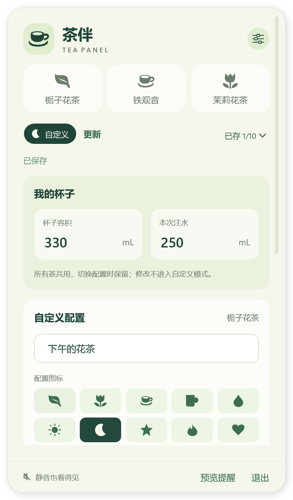
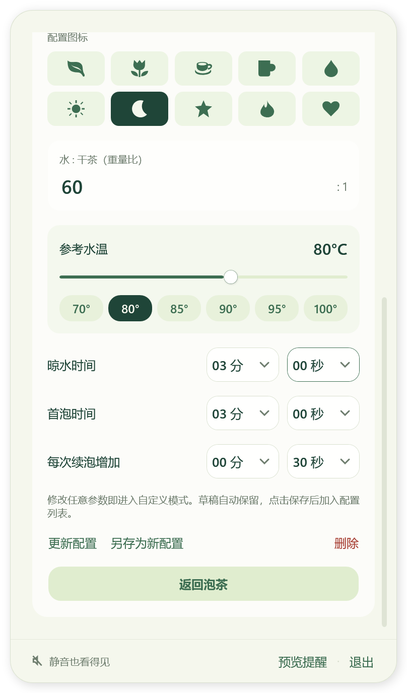

# Windows 验证与 Mac 界面对照

本地验证日期：2026-10-19。Actions 配置与文档更新日期：2026-10-20。源码版本 0.4.2，Windows 发布包尚未上传到 GitHub Releases。

## 环境

| 项目 | 实际环境 |
| --- | --- |
| 操作系统 | Windows 11 x64，系统版本 `10.0.26300` |
| SDK | .NET 10.0.402，仓库内的可选本地工具目录 |
| 运行时 | .NET 10.0.13 |
| 缩放 | 200%，单个当前工作屏幕 |
| 命令环境 | Windows PowerShell 5.1 构建脚本；PowerShell 7 做产物检查 |

## 已完成的检查

| 检查 | 结果 |
| --- | --- |
| `windows/test.ps1` | 92 项核心与本地存储检查通过 |
| `windows/test.ps1 -Desktop` | 78 项原生 WPF 桌面检查通过 |
| Windows 编译 | 零警告、零错误 |
| `windows/package.ps1` | 成功生成包含 .NET 运行时的 Windows x64 单文件 EXE 和 SHA-256，发布目录只有一个 EXE |
| 单文件隔离桌面检查 | 使用相同发布参数编译测试版，放到只有一个 EXE 的目录中，78 项检查全部通过；改名与带空格路径可运行 |
| 0.4.2 正式单文件启动 | 实际交付 EXE 独立启动并通过重复实例分支正常退出；提前建立互斥量，使启动在读取偏好前结束 |
| 0.4.0 正式包启动基线 | 解压程序进入消息循环并创建窗口，加载包内 `coreclr.dll`；第二个进程正常退出，首个继续运行 |
| 数据与测试隔离 | 0.4.2 核心和桌面检查使用隔离存储，不读写真实偏好；0.4.0 首次启动探针运行前后均无用户偏好文件 |
| 0.4.2 正式包内容 | EXE 内嵌 456 个文件，含 .NET 10.0.13 框架与 WPF；程序集与发布输出一致，含 MIT 许可证和动效实现，未编入桌面测试运行器 |
| 静态检查 | PowerShell、XML、工作流 YAML 解析及版本一致性通过；本地文档与图片引用有效，已修改及新增文本无行尾空白 |

核心检查覆盖三种默认配方、前四泡时间、8.25 → 8.3 的舍入、晾水与人工确认、跳过晾水及重复点击、续泡和中途起始泡次、本轮快照与下泡参数、草稿与已存配置、10 条上限、保存/重载、保存失败和损坏文件保留。

桌面检查通过真实 WPF 控件和窗口执行，覆盖参数绑定、错误输入修复、配置保存、非标准秒数保留、实际读数像素、`1010:00` 的长时长、固定的圆环位置、窗口开合与中途重开、失焦隐藏、计时到点卡片、持续提醒、预览、确认及退出清理。

0.4.2 直接参照 `Sources/TeaViews.swift` 和仓库的 Mac 截图重排界面：384 × 668 的内容区域、66 高的图标茶种卡片、紧凑的“已存 n/10”菜单、英雄卡片内的泡次标记、固定的 223/65 读数与圆环区域、并排等大的注水/泡次卡片、摘要分隔线和固定底栏。默认泡茶页无需滚动。

参数页采用 Mac 相同的杯子卡片、图标选择、参考温度与快捷温度、独立分/秒菜单，以及快捷保存/更新流程。修改分钟保留秒数，反之亦然；测试 125 秒保留、时长上限和首泡下限。渲染回归也检查首次出现的温度/阶段选中背景和时间菜单文字，避免空白选中态或文字省略。

检查窗口进入、切茶、设置切换和快速连改泡次时的真实渲染中间帧，在 `desktop-checks.json` 记录时间、透明度、位移和截图路径。另完整走过晾水、等待投茶、浸泡、泡好、准备续泡和跳过续泡晾水，保存各阶段截图。

提醒首次出现及复用窗口时，比较 `GetForegroundWindow` 和 `GetGUIThreadInfo` 的原生前台/键盘焦点句柄，显示前后保持相同。布局截图阶段会暂时固定测试菜单，之后单独启用并检查真实失焦隐藏。该探针没有模拟物理按键，也不等于完整人工打字验收。

普通动画和减少动态分支分别通过仅编入测试程序的局部设置验证，包括窗口、内容和读数过渡；正式程序始终读取 Windows 动画偏好。本次开发中观察到系统偏好先为关闭、后为开启，最终一次检查记录为开启，测试确认其开始与结束的值相同，没有修改系统全局开关。休眠经过时间通过注入时钟验证，未让本机实际进入休眠。

原始报告保留在本地生成目录：

- `build/windows/verification/desktop-checks.json`
- `build/windows/verification/singlefile-contents.json`：0.4.2 正式 EXE 内容与摘要
- `build/windows/verification/singlefile-desktop.json`：单文件隔离测试摘要，指向完整的 78 项桌面报告和主机加载日志
- `build/windows/verification/singlefile-production-startup.json`：正式 EXE 的重复实例启动检查，在偏好加载前退出
- `build/windows/verification/package-contents.json`：此前 0.4.2 目录 ZIP 的内容与摘要
- `build/windows/verification/package-smoke.json`：0.4.0 启动基线，摘要对应旧包
- `build/windows/verification/` 下的主面板、设置、提醒、选择框和 `motion-*` 动画中间帧

## 发布包

文件：`dist/Tea-Panel-0.4.2-Windows-x64.exe`，大小 **75,761,171 字节**（约 76 MB）。

SHA-256：

```text
dcd70a09a39953ed1c0cc4ff1138757318ec26bfe50758b9c0c3ce4977ec25ba
```

相应校验文件为 `.exe.sha256`，运行只需要 EXE。本次两次正式打包的摘要一致，重新构建后仍应以新校验文件为准。程序已包含运行时，不要求使用者安装 .NET 或 SDK；尚未在另一台全新、未装 .NET 的 Windows 机器上单独验收。

单文件测试将 `DOTNET_ROOT` 和 `DOTNET_ROOT_X64` 指向不存在的目录，从只有一个已改名 EXE 的目录运行。78 项桌面检查通过，实测 `PresentationNative_cor3.dll` 和 `wpfgfx_cor3.dll` 从独立的包释放缓存加载，启动目录没有产生旁置依赖。少量原生库的自动释放属于 [.NET 单文件机制](https://learn.microsoft.com/en-us/dotnet/core/deploying/single-file/overview#native-libraries)，用户无需解压。

正式 EXE 的主机日志确认自包含应用和包内程序集启动，重复实例分支以代码 0 退出。完整界面、数据交互使用同源单文件测试程序与隔离存储验收；未以真实偏好执行完整的正式启动。较早的正式目录包完整启动与单实例实测仍以 0.4.0 为基线。

以下 Mac 图为仓库中已有的 0.3.9 参考截图；Windows 为 0.4.2 实际 WPF 渲染，两边都使用默认栀子花茶、330 mL、第 1 泡。Windows 主图裁去透明阴影边距，两图均为 768 × 1336；没有重新运行 Mac 程序。系统字体和矢量图标保持各平台实现，不把两张图宣称为逐像素相同。

| macOS 参考 | Windows 0.4.2 |
| --- | --- |
|  |  |

以下卡片与设置页均从实际 WPF 窗口导出，使用隔离测试数据，不包含用户桌面或真实配方：






## 2026-10-20 Actions 实测

使用 `gh workflow run release.yml --ref main` 触发[运行 39358215202](https://github.com/Pommissarzhu/Tea-Panel/actions/runs/39358215202)，对应源码提交 `eedd23685a57b4995fa031b31b8d31474a7cb440`。

- `macos` 任务通过 193 项核心检查，构建并上传 Apple Silicon DMG 和校验文件。
- `windows` 任务通过 92 项核心与存储检查，调用相同的 `windows/package.ps1` 生成自包含单文件 EXE，产物文件与 SHA-256 校验通过。
- 两端 artifact 均上传成功。此次为手动运行，`publish` 按配置跳过，未创建 Release。
- 桌面、动效、物理休眠与多显示器验收范围保持上文记录，不将核心 CI 视为图形交互检查。

## 待验证的场景

- 物理鼠标点击托盘及其折叠菜单，快速反复开合。
- 在其他应用中持续实际打字时出现提醒。
- 真实休眠/唤醒和锁屏/解锁。
- 100%、125%、150% 等其他缩放及混合 DPI 的多显示器。
- 各类全屏应用，尤其独占全屏；不承诺覆盖所有独占全屏画面。
- 系统设置中实际关闭/打开动画，以及纯键盘完整操作。
- 另一台干净 Windows 11 机器上的单文件 EXE 运行。

2026-10-19 的本地验证未推送、未触发远端 CI、未创建新 Release。2026-10-20 的 Actions 配置使用同一个 `windows/package.ps1`，额外验证产物文件和 SHA-256，并在任务摘要中记录大小与校验值。手动工作流只生成 artifact，标签工作流才发布 Release；GitHub 网页对 artifact 的 ZIP 包装不改变内部单文件 EXE 格式。远端结果见 [Actions](https://github.com/Pommissarzhu/Tea-Panel/actions/workflows/release.yml)。

macOS 的 Swift 源码、测试和根目录脚本保持原位置；应用版本同步到 0.4.2/build 19，Windows 本地环境未重跑 macOS 构建、签名和原生测试。
